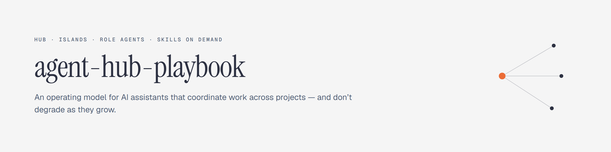
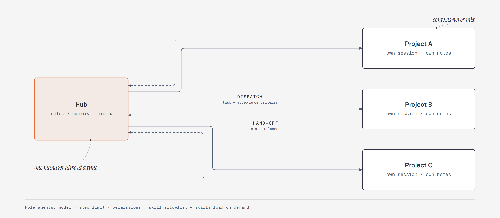
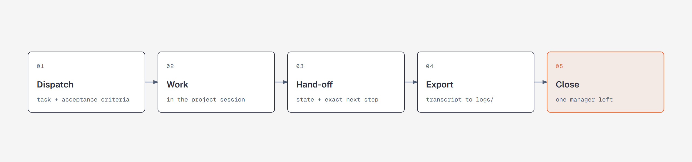

<picture>
  <source media="(prefers-color-scheme: dark)" srcset="assets/banner-dark.png">
  
</picture>

# agent-hub-playbook

A practical operating model for AI assistants that coordinate real work across projects — and don't degrade as they grow.

Most agent setups start strong and rot quietly: the instruction file bloats, every skill is announced to every agent, context fills up with noise, permissions live in prompt sentences, and the same mistakes come back every week. This playbook describes the alternative: a **hub** that coordinates, **isolated project sessions** that execute, **role agents** with deny-first permissions, **skills** loaded on demand, and a **lesson log** that turns every failure into a change in the machine.

It is not a framework. There is nothing to install. It is a specification, a set of templates, and the field lessons that cost us real incidents.

**[Lee esto en español →](README.es.md)** · **[Guía completa en español →](docs/es/modelo.md)**

---

## The model in 60 seconds

| Piece | What it is | Why it exists |
|---|---|---|
| **Hub** | A manager assistant in a personal workspace, with written rules and memory | One place that decides, dispatches and closes — never two managers alive at once |
| **Islands** | One session and one configuration per project | Mixing contexts makes sessions grow, compact and lose precision |
| **Role agents** | Markdown cards: model, step limit, permissions, skill allowlist | The expensive model thinks, the cheap one executes; readers never get a shell |
| **Skills** | Procedures on demand: a short description always visible, the body only when invoked | A 180-skill catalogue costs ~31k tokens per cold start; a per-role allowlist cut it to ~12k (measured) |
| **Lessons** | Date · error · root cause · action · status · evidence | An error that returns is a regression, not bad luck |
| **Closure** | Measure context → consistency check → hand-off → rotation | A new session starts from a written state, not from re-reading history |

<picture>
  <source media="(prefers-color-scheme: dark)" srcset="assets/model-dark.png">
  
</picture>

The full specification — principles, phases, interview, anti-patterns, operating protocol, templates — is in **[docs/model.md](docs/model.md)** (English) and **[docs/es/modelo.md](docs/es/modelo.md)** (Spanish).

---

## Quickstart

1. **Read the model** (`docs/model.md`), then run the interview in section 9 with your own assistant. Do not skip it: the system is adapted to your context, not copied.
2. **Write the constitution** (≤200 lines) from `templates/constitution.md`. Keep it short — a long instruction file is obeyed less.
3. **Create two agents** from the templates: one read-only explorer and one reviewer with no shell tool. Test that the reviewer literally cannot execute anything.
4. **Add 3 real skills** and a per-agent allowlist. Measure your cold start before and after.
5. **Do one real dispatch end-to-end:** assignment → hand-off in the project notes → transcript export → session deletion.

<picture>
  <source media="(prefers-color-scheme: dark)" srcset="assets/dispatch-dark.png">
  
</picture>

Phases, acceptance criteria and the full checklist are in section 8 and section 16 of the model.

---

## What this is — and what it is not

**It is:** an operating model, a sanitised specification, templates, and lessons from production use (permissions, cost, context, closure).

**It is not:** a product, a library, a hosted service, a prompt collection, or a replacement for your agent tool. It assumes a tool with subagents, skills and permission rules (we run it on OpenCode; the concepts map to other CLIs).

**Hard rules we don't negotiate:** evidence over claims, deny-first permissions, no shell for read-only agents, secrets out of the chat, and one recorded lesson per failure.

---

## How this repo evolves

This is a **curated edition**, not a mirror of a private system. A change is published only if it passes three filters:

1. It is generic (not tied to one person, project or vendor).
2. It contains no personal data, paths, costs, client names or identifiable incidents.
3. It has been tested in real use.

Releases follow `CHANGELOG.md`. Generic field lessons are added under `lessons/`; the specification is revised when the model itself changes. There is no support commitment — this is a playbook, not a product. Discussion and corrections are welcome.

---

## Repository layout

```
docs/
  model.md            English edition
  es/modelo.md        Spanish edition
assets/
  banner-*.png        README header (light / dark)
  model-*.png         hub + islands (light / dark)
  dispatch-*.png      one dispatch, end to end (light / dark)
  social-preview.png  repository social card (1280×640)
templates/
  constitution.md     Always-loaded rules (≤200 lines)
  agent.readonly.md   Read-only agent with no shell tool
  agent.reviewer.md   Reviewer: finds issues, fixes nothing
  skill.md            On-demand procedure
  memory.md           Dated facts, verified vs assumed
  lesson.md           Failure → machine change
  handoff.md          State + exact next step
lessons/
  agent-shell-permissions.md
  context-budget.md
CHANGELOG.md
LICENSE
```

---

## Field lessons included

- **Shell allowlists match by substring** — `*git diff*` also runs `cmd /c "… & git push --force"`, and an agent allow **overrides the global deny**. Read-only agents must not have the tool at all.
- **The skill catalogue is a cold-start tax** — 180+ announced skills ≈ 31k tokens before the first word; per-agent allowlists and `autoinvoke: false` bring it down.
- **A guard is a tripwire, not a cage** — global deny lists stop the obvious; they do not stop a script that deletes from the inside, or copies out of a worktree.

---

## License

MIT. See [LICENSE](LICENSE).
